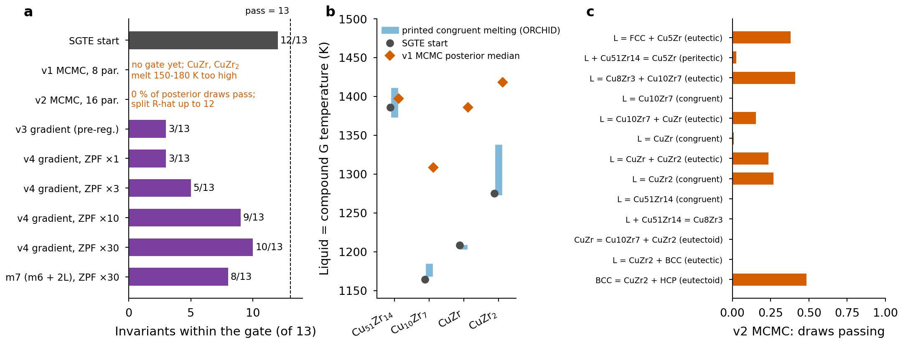

# Cu–Zr with classic ESPEI MCMC: a documented negative example

**For new fits:** see [Weighting revision for new fits](#weighting-revision-for-new-fits-2026-10-25). The results below retain their historical inputs.

This example shows the classic ESPEI route with ORCHID data: load the released ESPEI datasets with
`load_datasets`, choose evidence with `apply_tags`, and refine part of an existing assessment (the SGTE Cu–Zr
description of Zeng et al. 1994) with ESPEI's MCMC. It is kept as a **negative example**: in the study behind the
paper, no variant of this refinement passed the gate (best 10/13; the last, pre-registered fallback m7 reached 8/13),
and the figure and numbers below say so.



**What happened (orchid-espei-demo, 2026-10-23/24).** The gate requires every invariant reaction with a printed
ORCHID temperature in the fit set (13 reactions) to lie within twice its uncertainty of the nearest printed value.

| variant | method | result |
|---|---|---|
| SGTE start (Zeng 1994) | – | 12/13 (fails L + Cu51Zr14 = Cu8Zr3) |
| v1, 8 coefficients (liquid 0L, 1L; four compound constants) | ESPEI 0.9.1 MCMC (emcee), 16 chains × 1,500 iterations, 3.1 h | not converged; activities fit better, but CuZr and CuZr2 melt 150–180 K too high (panel b). ESPEI 0.9.1 gives no ZPF driving force for a liquid point at a line-compound composition once the compound is stable, so congruent melting constrains the model in one direction only |
| v2, 16 coefficients, + invariant brackets, assessed and liquid-stability points | ESPEI 0.9.1 MCMC, 2 × 32 walkers, stopped at ~955 iterations | not converged (split R-hat up to 12); 0 % of posterior draws pass (panel c) |
| v3, 6 coefficients (pre-registered) | gradient ESPEI (Kunselman), L-BFGS-B, 6 starts | 3/13 |
| v4, dense assessed-field points, ZPF weight ×1/×3/×10/×30 (post hoc; m6 = the v3 six-parameter model) | gradient ESPEI, 3 starts each | 3, 5, 9, 10 of 13; none passes |
| m7 (m6 + 2L liquid), ZPF ×30, post hoc (pre-registered fallback) | gradient ESPEI, 3 starts | activity RMSE fit/held-out 2.28/1.11 kJ/mol (SGTE 3.60/2.59), invariant MAE 29/26 K (SGTE 18/10), 8/13 reactions, **gate FAILS** |

**In plain terms: refining six or seven parameters of the 1994 assessment with ORCHID data improves the
activities but cannot keep the invariants within the gate.** Every refinement that fits the activities better moves
invariant temperatures away from the printed ones (v3: invariant MAE 18 → 54 K on the fit set; m7: 18 → 29 K), and
adding a third liquid term (m7) does not fix it. This is a model-adequacy result for this parameterisation of the
1994 description, not a defect of the data. The paper's Cu–Zr example therefore uses the PhaseForgePlus gradient route
instead (`../cuzr-phaseforgeplus`: a full MLIP-informed parameter set tuned with more phase evidence, 9/13, in-sample).

The m7 result is in `cached/v4_m7/` (summary from orchid-espei-demo commit 487f746), with its starting and
refined databases in `tdb/review_only/` (`CuZr-94Zen-LB_param_v4_m7.tdb`, `CuZr-94Zen-LB_ORCHID-v4_m7_REVIEW-ONLY.tdb`:
**review only, not an assessment; do not copy into a database**) and the scripts that produced it in
`scripts/source_v4_m7/` (reference copies; they need the source repository). Other refined TDBs and all chains are
not distributed (`../ZENODO_LARGE_FILES.md`).

## Quick path: cached summary → figure (no ESPEI, about 40 s)

```sh
python -m venv .venv && . .venv/bin/activate      # CPython 3.12
pip install -r requirements.txt                  # numpy 2.3.2, matplotlib 3.10.7
sh run_quick.sh                                  # -> figures/fig_espei_negative.{png,pdf}, figures/gate_sgte_start.json
```

`cached/espei_demo_summary.json` holds the numbers of every variant, extracted from orchid-espei-demo's result
files (posterior summaries, gate tables; no chains). `scripts/gate.py` recomputes the SGTE start's gate (12/13) with the
analytic Cu–Zr model of `cuzr-phaseforgeplus`.

## Full path: select data, run ESPEI MCMC, apply the gate

ORCHID data: orchid-data commit **`778cc6bfa67db292e3f917f5ac6d691e0f37fc1a`** (the release used by the PhaseForge+
example; the cached v1–v4 results were run on earlier 2026-10-23/24 states of the bundle, so a rerun will not
reproduce them exactly). Files are fetched from the pinned commit (or from `ORCHID_DATA`, a local checkout at that
commit; see `../common/orchid_data.py`).

```sh
python -m venv .venv-espei && . .venv-espei/bin/activate      # CPython 3.13
pip install -r requirements-full.txt                         # ESPEI 0.9.1, pycalphad 0.11.2, emcee 2.2.1, dask
python scripts/select_datasets.py --iterations 1500 --cores 5 [--evidence measured] [--drop-single-reader]
cd work && espei --input espei-in.yaml && cd ..
python scripts/gate.py --trace work/trace.npy --tdb work/refined_REVIEW_ONLY.tdb
```

`select_datasets.py` gathers the Cu–Zr datasets of the chosen evidence classes (experimental, invariant tables,
literature DFT for CuZr-94Zen-LB; optionally the derived invariant brackets, liquid-stability points and assessed
phase-assemblage points), keeps those whose phases map to CuZr-94Zen-LB through the ORCHID phase registry, loads them
with `espei.datasets.load_datasets`, applies the tag choices with `apply_tags` (the same tags go into
`espei-in.yaml`), and writes the ESPEI input: 8 coefficients of `tdb/CuZr-94Zen-LB_param.tdb` (made by
`scripts/make_param_tdb.py`), normal priors centred on the SGTE values (sd = |value|), 2 chains per parameter.
At the pinned release it keeps 104 datasets (32 activity, 17 formation-enthalpy, 55 phase-equilibrium).

Measured cost: one MCMC iteration (16 chains, 104 datasets) takes about 40 s on one core of a Mac Studio M1 Max, so
1,500 iterations take about 16 h on one core or about 3 h with 5 dask workers (v1: 3.1 h). A 2-iteration smoke run
(`--iterations 2 --scheduler none`, about 2 min) finished with finite log-probabilities for all 16 chains; it is
not a result. Chains and refined databases are not committed (`work/` is git-ignored).

## Credits

ESPEI (B. Bocklund et al., MRS Commun. 9 (2019) 618, doi:10.1557/mrc.2019.59) and pycalphad (R. Otis, Z.-K. Liu,
J. Open Res. Softw. 5 (2017) 1, doi:10.5334/jors.140); the gradient variants v3/v4 used C. Kunselman's analytic-gradient
ESPEI branch (see `../cuzr-phaseforgeplus`). Starting model: K.-J. Zeng, M. Hämäläinen, H.L. Lukas, J. Phase Equilib.
15 (1994) 577 (doi:10.1007/BF02647618), from B. Hallstedt, Calphad 89 (2025) 102833 (CC BY 4.0), unchanged in
`tdb/CuZr-94Zen-LB.tdb`.

## Weighting revision for new fits (2026-10-25)

The current ORCHID bundle splits literature groups with unequal effective uncertainties into individual fitting records. Each exported weight is the ESPEI reference sigma divided by the observation's effective sigma (activities use chemical-potential sigma). Reported uncertainties, estimated components, source values, and calibrations are preserved. The superseded median-group policy and optional weight-floor fields are historical comparisons, not instructions for new fits.

For a new fit, use a clean directory from the regenerated bundle and run `python espei/check_weights.py --bundle espei` before selection or user weight overrides. Retain the exported weights, avoid loading removed parent datasets alongside their children, and record the release/commit, input hashes, ESPEI version, selected evidence, and any tag or property weight overrides. `espei/UNCERTAINTY_SPLITS.json` maps the old files to their replacements. The shared source links remain available, but splitting does not establish independence or supply covariance between measurements.

The results reported in this example use their archived input manifests and historical weighting choices. They have not been refitted under the revised export. The pinned example reproduces that historical analysis; using the current bundle constitutes a new run and requires a separate manifest and validation. In particular, the legacy `orchid-espei-demo/scripts/build_data.py` applies its historical HMR/SMR cap unless `--bundle-weights` is passed; preserve that behavior only when reproducing those archived runs.
