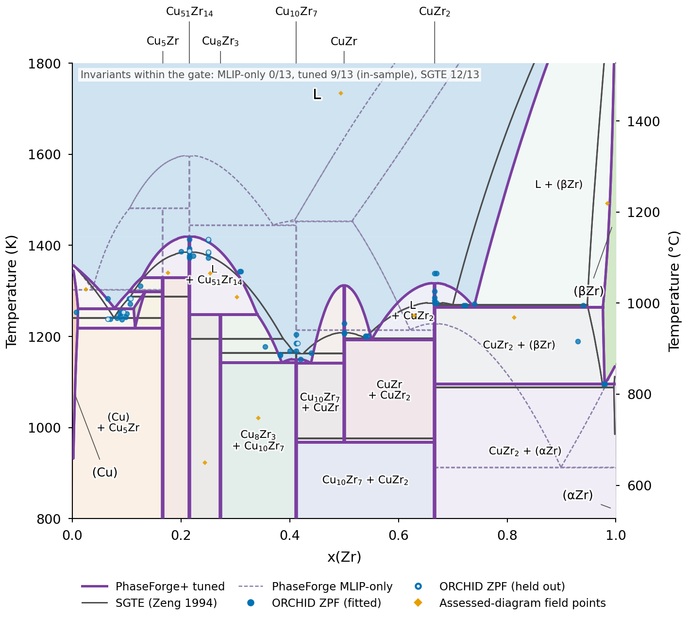

# Cu–Zr with PhaseForge and PhaseForge+: MLIP → CALPHAD → gradient tuning against ORCHID data

This example reproduces the Cu–Zr figure of the ORCHID paper. A CALPHAD description of Cu–Zr is built with the
PhaseForge workflow from the energies of a machine-learned interatomic potential (GRACE-2L-OMAT) alone, and then tuned
with PhaseForge+ (the gradient-based ESPEI branch of C. Kunselman) against ORCHID's phase-equilibrium, activity and
formation-enthalpy data. The figure overlays three descriptions: the SGTE assessment of Zeng et al. (1994), the
MLIP-only (one-shot) PhaseForge description, and the tuned one.



| description | invariants within the gate |
|---|---|
| SGTE CuZr-94Zen-LB (Zeng et al. 1994) | 12/13 |
| PhaseForge, MLIP energies only | 0/13 |
| PhaseForge+, tuned with ORCHID data | **9/13, in-sample** |

**Read the 9/13 honestly.** The gate asks whether each of the 13 invariant reactions with a printed temperature in the
fit set lies within twice its uncertainty (u printed, else 5 K) of the nearest printed value. The tuned description
was fitted to the phase-equilibrium data behind those printed values, so 9/13 is an in-sample measure of fit quality,
not a prediction. It is also a post-hoc result: the pre-registered PhaseForge+ fit reached 4/13, and the final
configuration (more weight on phase data, a dense grid of assessed-field points, a linear T term for B2 CuZr) was
chosen after that. The tuned description still places the congruent melting of CuZr 106 K too high (1312 K vs
1206 K), the CuZr eutectoid 16 K too low (969 K vs 985 K), misses the Cu5Zr peritectic and the CuZr2 melting point, and
has a narrow spurious (βZr) field near x(Zr) = 0.1 between 1220 and 1290 K. Out-of-sample checks: held-out liquid
activities (RMSE 5.1 → 1.7 kJ/mol for MLIP-only → tuned; SGTE 2.6) and held-out phase-equilibrium driving force (1.7 → 0.11 kJ/mol, SGTE 0.12)
(`cached/demo_results.json`, `metrics`). It is a demonstration of data reuse, not a new Cu–Zr assessment.

## Quick path: cached TDBs → gate table and figure (no GPU, about 3–4 min)

```sh
python -m venv .venv && . .venv/bin/activate          # CPython 3.12
pip install -r requirements.txt                      # numpy 2.3.2, matplotlib 3.10.7
sh run_quick.sh                                      # -> figures/gate.json, figures/fig_cuzr_overlay.{png,pdf}, fig_cuzr_panels.{png,pdf}
```

`scripts/gate.py` computes the invariant temperatures of the three TDBs and the gate (prints the table; about 30 s).
`scripts/fig_overlay.py` draws the overlay and a three-panel version (about 2.5 min). Both use `scripts/model.py`, an
analytic evaluation of this TDB family (two-term Redlich–Kister solutions, line compounds, SGTE unaries tabulated once
with pycalphad in `inputs/unary_tables.npz`) with the equilibrium read from the lower convex hull; it was validated
against pycalphad equilibria in the source repository. No ORCHID download is needed: the ORCHID points drawn on the
figure are in `inputs/zpf_points.json` and the printed invariant temperatures in `inputs/printed_invariants.json`,
both derived from the release pinned below. The figure uses DejaVu Sans so that it regenerates byte-identically; the
paper's version uses Arial (`ORCHID_FIG_FONT=Arial`).

## Full path: the whole workflow (compute requirements and timings)

ORCHID data: release commit **`778cc6bfa67db292e3f917f5ac6d691e0f37fc1a`** of
[orchid-data](https://github.com/orchid-calphad/orchid-data) (2026-10-24, the release the final fit used). The
current release head differs; numbers from another commit will differ (the audit rounds after that release changed, among
others, the Cu–Zr invariant brackets and the one-point-per-field assessed set). The full-path scripts read a local checkout:

```sh
git clone https://github.com/orchid-calphad/orchid-data && git -C orchid-data checkout 778cc6bfa67db292e3f917f5ac6d691e0f37fc1a
export ORCHID_DATA=$PWD/orchid-data
```

The 177 dense assessed-field points of the final fit are released from orchid-data commit
**`e6b9b3f649e612ed8432f5487304c78910ab7604`** on (`espei/assessed/CU-ZR/CuZr-94Zen-LB.CU-ZR-p371.dense.json`, the
`dense-field-grid/` records of `assessed-phase-assemblages`). `build_a4.py` reads that file from `ORCHID_DENSE_DATA`
(a checkout of that commit; default `ORCHID_DATA` when it holds the file) and verifies its sha256
(`62b78ff8…`):

```sh
git -C orchid-data fetch && git clone orchid-data orchid-data-dense && git -C orchid-data-dense checkout e6b9b3f649e612ed8432f5487304c78910ab7604
export ORCHID_DENSE_DATA=$PWD/orchid-data-dense      # or point ORCHID_DATA at that commit to use one checkout for everything
```

All outputs go under `work/` (git-ignored). Steps, in the source repository's order (`scripts/full/`, copied from
orchid-phaseforge-demo with only the paths changed):

| step | script | environment | measured cost (Mac Studio M1 Max, CPU) |
|---|---|---|---|
| SQS for FCC_A1, BCC_A2, HCP_A3 (64 atoms) and liquid starts (108 atoms) with m_scraps (replaces ATAT `mcsqs`) | `sqs_mscraps.py` (+ `validate_sqs.py`) | `requirements-mlip.txt` | minutes |
| compound structures (Ghosh 2007; Cu51Zr14 65-atom model of Zhong 2013) | `compounds.py` | mlip | seconds |
| MLIP relaxations, 22 structures (FIRE, fmax 0.001 eV/Å, full cell) | `mlip_relax.py` | mlip | 0.5 h |
| liquid MD at 2178 K, 5 compositions × 15,000 steps × 108 atoms | `liquid_md.py` | mlip | 10.2 process-h, 2.3 h wall with 5 in parallel (95 % of the cost) |
| Redlich–Kister fit, TDB assembly on SGTE unaries | `build_mlip_tdb.py` | mlip | < 1 min |
| σ_MLIP from ORCHID's DFT calibration; MLIP constraint datasets | `sigma_mlip.py`, `make_anchor.py` | fit | seconds |
| ORCHID data: fit / hold-out / DFT-check sets | `build_data.py`, `printed_invariants.py` | fit | seconds |
| final-fit data (F10b: ZPF weights ×10, HM_FORM σ floors) | `build_a4.py a4d` | fit | seconds |
| gradient fit, CG then L-BFGS-B to convergence, five starts | `fit_pr268.py` | `requirements-fit.txt` | 20–30 min per start (final start: 409 evaluations, 1,619 s) |
| evaluation, gate, physical-validity check | `evaluate.py`, `validity.py`, `../gate.py` | fit | minutes |
| NUTS (gradient-informed HMC) exploration and UQ | `hmc_hessian.py`, `hmc_nuts.py`, `hmc_refine.py` | fit | 2–2.5 h wall per chain (3.2–3.9 s per lnL + gradient) |

The MLIP steps need no GPU (GRACE ran on CPU here); on a GPU the liquid MD drops to minutes. The final fit was:

```sh
python scripts/full/build_data.py && python scripts/full/printed_invariants.py
python scripts/full/sigma_mlip.py && python scripts/full/make_anchor.py
python scripts/full/build_a4.py a4d
for s in 0 1 2 3 4; do      # five starts in parallel in the paper run; s3 was selected (validity, then gate, then lnL)
  python scripts/full/fit_pr268.py $s --data data/a4d_F10 --tdb tdb/CuZr-PhaseForge-MLIP-B2b.tdb \
     --out runs/final2/F10b_s$s --wall 5400 --extra-meta '{"VV0022": "CUZR_B2 b [J/mol formula/K]"}' &
done; wait
```

Checks done for this repository: with `ORCHID_DATA` at the pinned commit, `build_data.py` and `printed_invariants.py`
reproduce the source repository's fit, hold-out and DFT-check datasets and printed-invariant table byte for byte, and
`build_a4.py a4d` reproduces all 77 files of the final-fit data set identically and, with the released dense grid, the
78th: the same 177 points (temperatures bit for bit, compositions, phase sets, weight 1 × F); only the order of the two phases
within a two-phase point differs from the source repository's file, and the file carries the release's extra metadata
(`orchid`, `orchid_uncertainty_budget`). The MLIP, fit and NUTS steps were not rerun here; their outputs are cached (`cached/final_fit/` holds the
selected start's result and optimizer trace, `cached/final_fit/all_starts.json` all five starts, `cached/hmc/` the NUTS
summary).

**The dense assessed-field grid.** The paper's final fit adds 177 ZPF points placed on a regular grid inside the fields
of the assessed Cu–Zr diagram (Okamoto 2008; handbook-class evidence, derived coordinates and phase assemblages only). They
are released in ORCHID (assessed-phase-assemblages, `dense-field-grid/`, `point_method` = `dense_field_grid`, with their
uncertainty budget, basis and citations; method in the dataset's README) and `build_a4.py` loads them from the release.
As in the final fit every point has weight 1 (× the ZPF factor F); the release also records `field_weight_share`
(1 / points in the field, so that a field counts as one observation) for fits that weight the points of one diagram as
dependent. The other final-fit data come from the older pinned release above, not from the commit that holds the dense
grid: rebuilding everything from the newer release gives a different data set (and would need a new fit).

## Files

- `tdb/CuZr-94Zen-LB.tdb`: SGTE Cu–Zr dataset (K.-J. Zeng, M. Hämäläinen, H.L. Lukas, J. Phase Equilib. 15 (1994) 577,
  doi:10.1007/BF02647618), from B. Hallstedt, "The SGTE collection of binary datasets", Calphad 89 (2025) 102833,
  doi:10.1016/j.calphad.2025.102833, CC BY 4.0, unchanged (sha256 4cce85fd…).
- `tdb/CuZr-PhaseForge-MLIP.tdb` (MLIP-only, GRACE-2L-OMAT), `tdb/CuZr-PhaseForge-final.tdb` (tuned; source run
  `runs/final2/F10b_s3`), `tdb/CuZr-PhaseForge-MLIP-B2b.tdb` (fit start with the CuZr T term), `tdb/mlip_fit.json`
  (MLIP energies and Redlich–Kister fit). The SGTE unaries and phase definitions in these files are copied from
  CuZr-94Zen-LB (CC BY 4.0). Review-only demonstration models: do not copy them into a database.
- `inputs/`: unary tables, printed invariants and figure points (derived from the pinned release), σ_MLIP.
- `cached/`: `gate.json` (output of `gate.py`), `demo_results.json` (invariant table, compound enthalpies, per-type
  RMSE of the source repository's analysis), `final_fit/`, `hmc/`.

## Software and credits

PhaseForge (Sarıtürk, Zhu, Arróyave; github.com/dogusariturk/PhaseForge @ 4f88f0d), PhaseForgePlus (Sarıtürk,
Kunselman, Zhu; github.com/dogusariturk/PhaseForgePlus @ b926502), MaterialsFramework (Sarıtürk;
github.com/dogusariturk/MaterialsFramework @ 0ec8168), m_scraps (Arróyave; github.com/rarroyave/m_scraps @ 776e698),
ESPEI with **Courtney Kunselman's analytic-gradient branch** (github.com/cjkunselman18/ESPEI @ 9039ea2, the head of the
unmerged pull request PhasesResearchLab/ESPEI#268; the MLIP build venv pinned 4888897 as PhaseForgePlus's lockfile does),
pycalphad (develop @ 9a6939d), and **Kunselman's littlemcmc fork** (github.com/cjkunselman18/littlemcmc @ 2917bee) for
NUTS following her gradient-informed HMC protocol. All are public; none of their code is copied here. Known issues
found in PhaseForgePlus 0.1.0 (its MLIP regularizer is silently empty) are described in the source repository's README;
here the constraint is written explicitly (`make_anchor.py`). See the top-level README for citations.
