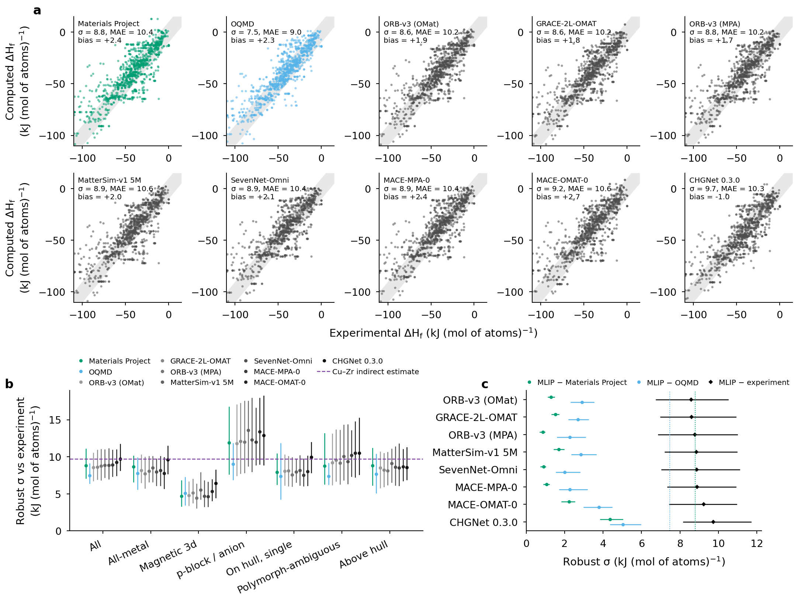

# MLIP formation enthalpies against ORCHID experiments: the saturation benchmark

Eight universal machine-learned interatomic potentials (MLIPs) are compared with ORCHID's experimental formation
enthalpies using exactly the rules of ORCHID's DFT-versus-experiment benchmark (Dataset 4): the same pairs, the same
default subset, the same strata, the robust σ (1.4826 × median absolute deviation) and the same seeded
system-cluster bootstrap. The result is a saturation: every MLIP lands on its DFT teacher.



On 1,138 identical records (455 compounds, 185 chemical systems), the robust σ of MLIP − experiment is 8.6–9.7
kJ (mol of atoms)⁻¹, against 8.8 for the Materials Project and 7.5 for OQMD. The paired system-cluster bootstrap
of σ_MLIP − σ_MP contains 0 for every model, and each MLIP's residuals correlate with MP's at r = 0.96–0.997, while the
MLIPs reproduce MP to σ 0.9–4.4. The error against experiment is DFT's, so a 0 K formation-enthalpy benchmark cannot
rank MLIPs for phase-stability work; `oneshot-benchmark/` is the test that can.

| source | robust σ [95 % system-cluster CI] | σ − σ_MP [95 % CI] | r(residual, MP residual) |
|---|---|---|---|
| OQMD | 7.5 [6.4, 9.1] | – | – |
| ORB-v3 cons.-inf. OMat | 8.6 [6.8, 10.5] | −0.22 [−0.92, +0.43] | 0.996 |
| GRACE-2L-OMAT | 8.6 [7.0, 10.9] | −0.19 [−0.92, +0.56] | 0.992 |
| ORB-v3 cons.-inf. MPA | 8.8 [6.9, 11.0] | −0.02 [−0.62, +0.42] | 0.995 |
| Materials Project | 8.8 [7.1, 11.0] | – | – |
| MatterSim v1.0.0-5M | 8.9 [7.2, 11.0] | +0.05 [−0.66, +0.74] | 0.975 |
| SevenNet-Omni (mpa head) | 8.9 [7.0, 11.1] | +0.07 [−0.47, +0.65] | 0.997 |
| MACE-MPA-0 | 8.9 [7.4, 10.9] | +0.09 [−0.65, +0.88] | 0.992 |
| MACE-OMAT-0 | 9.2 [7.4, 11.0] | +0.44 [−0.59, +1.10] | 0.987 |
| CHGNet 0.3.0 | 9.7 [8.2, 11.7] | +0.93 [−0.43, +2.40] | 0.961 |

## Quick path: cached predictions → statistics and figure (no GPU, about 30 s)

```sh
python -m venv .venv && . .venv/bin/activate      # CPython 3.12
pip install -r requirements.txt                  # numpy 2.3.2, matplotlib 3.10.7 (the analysis itself is standard library)
sh run_quick.sh                                  # -> results/summary.json, figures/mlip_benchmark.{png,pdf}
```

`scripts/analyze.py` reads `inputs/pairs_identical_set.csv` (one row per experimental record: experiment, MP, OQMD,
each MLIP, with the record's system, chemistry class and DFT match quality), computes the statistics with
`scripts/estimators.py` (copied unchanged from ORCHID's calibration code) and checks every σ, MAE, cluster CI,
stratum, saturation interval and MLIP-vs-DFT σ against the source benchmark (`cached/CALIBRATION_MLIP_reference.json`):
the maximum difference is 0. Point-bootstrap intervals of the source (which depend on the original record order) are
not recomputed; all intervals quoted are system-cluster intervals.

## Full path: rerun the MLIPs (compute requirements and timings)

ORCHID data: orchid-data commit **`1e5f4ce7d189da3395798135f7726f79af67703f`** (after ORCHID audit round 2; the
experimental values and DFT pairs), with the calibration code of orchid-project.org commit
`181ebd6001a41f93de539a288fbf96cb1f5bdab2`. Later releases change the experimental set; numbers will move.

1. **Relax 926 structures with each MLIP** (853 binary compounds matched by Dataset 4 + 73 elemental ground states,
   Materials Project 2026.04.13 GGA/GGA+U structures, `inputs/structures.json.gz`, CC BY 4.0; 5 structure-matched
   polymorphs in `inputs/structures_addendum_r2.json`):
   `python scripts/full/run_mlip.py --model <key> --inputs inputs/structures.json --out results/raw [--device cuda]`
   (the scripts read the shipped `inputs/structures.json.gz` directly when `structures.json` is absent; hashes are of the decompressed JSON). Protocol: FIRE + FrechetCellFilter, fmax 0.02 eV/Å, ≤ 1000 steps,
   plus single points on the DFT structures; models and licences in `scripts/full/models.json`. Environments: one per
   family because of dependency conflicts, pinned in `env/` (`requirements-{grace-cpu,torch,mace,uma}.txt` with
   `constraints-*.txt`; MaterialsFramework @ 0ec8168, GPL-3.0). Measured: 30–48 min wall per machine on three NVIDIA
   DGX Spark (GB10; the seven PyTorch models on GPU, GRACE on CPU), 0 errors; median 0.2–1.4 s per compound per model;
   an estimated 4–8 GPU-h on H200-class GPUs (not measured). On a CPU only, budget several days.
2. **Pair with experiment:** `python scripts/full/analyze_raw.py --site-rev=181ebd6001a41f93de539a288fbf96cb1f5bdab2
   --data-rev=1e5f4ce7d189da3395798135f7726f79af67703f --inputs inputs/structures.json inputs/structures_addendum_r2.json
   --results results/raw --out results/full_analysis` with `ORCHID_SITE_REPO` and `ORCHID_DATA_REPO` pointing to git
   checkouts of orchid-calphad/orchid-project.org and orchid-calphad/orchid-data (it extracts the pinned commits with
   `git archive`). It writes `pairs_identical_set.csv`, the quick path's input.

UMA / eSEN were not run (gated weights); OQMD-structure variants are pending (the OQMD API was down on 2026-10-24).

## Caveats

MLIP-vs-DFT agreement partly measures memorisation (every model was trained on data containing these MP structures or
their relatives); MLIP vs experiment is the clean test. The MP2020 correction of the matched entry is added for every
model except CHGNet (trained on corrected energies). 0 K energies are used as 298 K enthalpies. Raw relaxation outputs
(about 40 MB) are listed in `../ZENODO_LARGE_FILES.md`.

## Credits

Models: GRACE-2L-OMAT (Bochkarev, Lysogorskiy, Drautz; ASL, non-commercial, results publishable), MACE-MPA-0 and
MACE-OMAT-0 (mace-torch), SevenNet-Omni, ORB-v3 (Orbital Materials), MatterSim v1.0.0-5M (Microsoft), CHGNet 0.3.0;
all run through MaterialsFramework (D. Sarıtürk). Structures and DFT energies: Materials Project (Jain et al. 2013)
and OQMD (Saal et al. 2013; Kirklin et al. 2015), CC BY 4.0. Experimental values: ORCHID literature release; cite the
original source of each value (record ids in the CSV).
