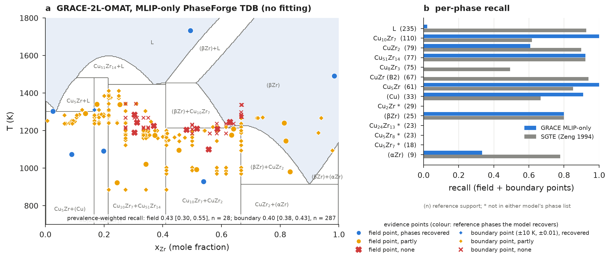

# One-shot MLIP phase diagrams scored against ORCHID (Cu–Zr)

Can a machine-learned interatomic potential (MLIP), with no fitting to experiment, produce a usable phase diagram?
This example scores a "one-shot" CALPHAD description built from MLIP energies alone (PhaseForge, GRACE-2L-OMAT; see
`../cuzr-phaseforgeplus`) against ORCHID's phase evidence for Cu–Zr. Phase equilibrium is treated as a classification
problem: at every evidence point (T, x) the reference phase assemblage is compared with the model's, and the primary
metric is the **prevalence-weighted recall** of phase presence (each phase weighted by its support in the
evidence, coexistence counted). The track idea is J. Saal's; the metric is the PI's `phase_presence_metrics`.



| model | field points (n = 28) | boundary points (n = 287) |
|---|---|---|
| **GRACE-2L-OMAT, MLIP-only (no fitting)** | **0.43 [0.30, 0.55]** | **0.40 [0.38, 0.43]** |
| SGTE CuZr-94Zen-LB (Zeng 1994), reference | 0.72 [0.59, 0.84] | 0.73 [0.70, 0.76] |
| PhaseForge+ final, **in-sample** (fitted to part of this evidence) | 0.76 [0.64, 0.87] | 0.66 [0.62, 0.69] |
| ten later Cu–Zr assessments (Hallstedt's SGTE collection), excluding Saunders 1985 | 0.70–0.98 | 0.62–0.78 |

95 % percentile bootstrap over points (2,000 resamples). Boundary points are correlated; cluster bootstraps by
equilibrium and by source are in each results JSON (GRACE boundary: [0.36, 0.44] and [0.34, 0.46]). Paired GRACE − SGTE:
field −0.30 [−0.43, −0.16], boundary −0.33 [−0.36, −0.30] (`results/comparison.json`). GRACE fails mainly on the
liquid (recall 0.02: the compounds and (βZr) are far too stable relative to the liquid), and B2 CuZr and Cu8Zr3 are
never stable. One system only: this tests the design of the track, it is not yet a benchmark.

**Seven more MLIPs, same protocol (DGX Spark builds, 2026-10-24).** CHGNet 0.3.0, MatterSim 5M, ORB-v3 (OMat and MPA),
MACE (MPA-0 and OMAT-0) and SevenNet-Omni, plus a rerun of GRACE-2L-OMAT on the Spark (CPU), each built by PhaseForge from
that MLIP's energies alone (21 relaxations, 5 liquid MD runs; `tdb/CuZr-PhaseForge-MLIP-<model>.tdb`, scores in
`results/mlips/`, table in `results/mlips_summary.md`):

| model (MLIP-only, no fitting) | field S [95% CI] | P | F1 | boundary S [95% CI] | P | F1 |
|---|---|---|---|---|---|---|
| MACE-MPA-0 | 0.56 [0.42, 0.69] | 0.53 | 0.51 | 0.53 [0.50, 0.56] | 0.64 | 0.53 |
| ORB-v3 MPA | 0.54 [0.40, 0.67] | 0.50 | 0.42 | 0.47 [0.44, 0.49] | 0.52 | 0.36 |
| ORB-v3 OMat | 0.48 [0.36, 0.60] | 0.45 | 0.41 | 0.46 [0.43, 0.49] | 0.52 | 0.40 |
| SevenNet-Omni | 0.46 [0.34, 0.59] | 0.41 | 0.40 | 0.42 [0.39, 0.44] | 0.57 | 0.44 |
| MACE-OMAT-0 | 0.46 [0.32, 0.60] | 0.60 | 0.46 | 0.45 [0.42, 0.48] | 0.63 | 0.49 |
| MatterSim 5M | 0.44 [0.31, 0.58] | 0.41 | 0.36 | 0.41 [0.39, 0.43] | 0.47 | 0.39 |
| GRACE-2L-OMAT | 0.43 [0.30, 0.55] | 0.41 | 0.33 | 0.41 [0.38, 0.43] | 0.51 | 0.31 |
| CHGNet 0.3.0 | 0.35 [0.22, 0.49] | 0.44 | 0.34 | 0.35 [0.31, 0.39] | 0.54 | 0.35 |
| SGTE 94Zen (reference) | 0.72 [0.59, 0.84] | 0.65 | 0.66 | 0.73 [0.70, 0.76] | 0.72 | 0.71 |
| PhaseForge+ final (in-sample) | 0.76 [0.64, 0.87] | 0.65 | 0.69 | 0.66 [0.62, 0.69] | 0.73 | 0.67 |

Intervals are point bootstraps (boundary points are correlated; cluster intervals are in each JSON). The intervals of the
eight MLIPs overlap broadly (field S 0.35-0.56), all lie below SGTE (0.72), and the ranking is not statistically
resolved with 28 field points. The Spark GRACE rerun reproduces the Studio build exactly at the field points (0.426) and
within 0.01 at the boundary points (0.410 against 0.401; 10 of 315 predicted assemblages differ, from MD sampling noise
in the liquid energies). With one system and 28 field points this is still a test of the track's design, not a benchmark.

## Quick path: cached scores → figure; grid scoring (no pycalphad, about 30 s)

```sh
python -m venv .venv && . .venv/bin/activate      # CPython 3.12
pip install -r requirements.txt                  # numpy 2.3.2, scipy 1.16.1, matplotlib 3.10.7
sh run_quick.sh                                  # -> figures/fig_cuzr_oneshot.{png,pdf}, figures/grace_grid_score.json
```

`scripts/figure.py` draws the GRACE phase map (cached as `results/map_cuzr_grace.npz`, 4 K × 0.004 grid computed with
pycalphad) with the evidence points and the per-phase recall from `results/*.json`. The run then exercises the grid
path below on that cached map: it reproduces the TDB scores (0.426 / 0.401).

## Score your own model

**From a TDB** (full path; pycalphad):

```sh
pip install -r requirements-full.txt              # pycalphad 0.11.2 and its pinned dependencies (CPython 3.12)
python scripts/score.py my_model.tdb --label my_model [--names-as CuZr-94Zen-LB.tdb]
python scripts/compare.py                         # paired bootstraps of the three reference models
python scripts/summarize_mlips.py                 # table of the MLIP-only scores (results/mlips_summary.md)
```

Phase names are mapped to ORCHID phase-registry ids through the registry's TDB names; a TDB the registry does not
know but which uses the phase names and sublattice models of a known file (as the PhaseForge TDBs use those of
CuZr-94Zen-LB) takes `--names-as`. Unknown phases become their own class (they can only add false positives).
Settings (same for every model): `pycalphad.equilibrium` at P = 101325 Pa, phases with NP > 1e-6, `pdens` 500; field
points one equilibrium; boundary points the union over a 5 × 5 band of T ± 10 K, x ± 0.01; failed cells re-solved
(drop-one-phase rule). About 15–60 s per model on one core.

**From an equilibrium grid** (any method: direct MLIP free energies, ML classifiers, digitised diagrams):

```sh
python scripts/score_grid.py my_grid.csv --label my_model     # columns T_K, x_Zr, phases ("LIQUID;CU10ZR7")
```

Phases are benchmark classes (`LIQUID, FCC_A1, BCC_A2, HCP_A3, C15B_CU5ZR, CU51ZR14, CU8ZR3, CU10ZR7, CUZR_B2, CUZR2,
CU24ZR13, CU2ZR, CU5ZR8, CU5ZR7`) or, with `--names-as FILE.tdb`, phase names of a registry TDB. Use at most
5 K × 0.005 over 700–1800 K; `scripts/npz_to_grid.py` writes the cached GRACE map in this format as a template.

## Evidence and release

ORCHID data: orchid-data commit **`c3d9781c26f72baaad64dd2b6aa6126ba487659e`** (release v2026.10, 2026-10-24).
`scripts/build_evidence.py` (full path; files fetched at that commit or from `ORCHID_DATA`) writes
`inputs/evidence.json`: 28 field points from Dataset 6 (assessed phase assemblages, one point inside each named field
of the assessed Cu–Zr diagram of Okamoto's handbook; released derived coordinates only) and 287 boundary points from
the literature ESPEI datasets (`espei/experimental/CU-ZR/*zpf*`, `espei/invariants/CU-ZR`; one equilibrium per ORCHID
observation id, each vertex a point). Points that were in the PhaseForge+ fit set are flagged from
`inputs/phaseforge_fit_split.json` (observation ids and field phase sets only). At this commit the evidence is
identical point for point to the source benchmark's (built at commit 0d9f7c4c3), and all 13 models rescored in the
pinned environment give identical per-point predictions (`scripts/score_all.sh`, 8 min in total on one core).

## Files

`tdb/`: CuZr-PhaseForge-MLIP.tdb (GRACE one-shot), CuZr-PhaseForge-final.tdb (PhaseForge+, in-sample),
CuZr-94Zen-LB.tdb and `reference_panel/` (ten later Cu–Zr assessments as transcribed in B. Hallstedt, Calphad 89 (2025)
102833, CC BY 4.0, unchanged; cite each original assessment named in the file header). `results/`: scores per model
(per-point predictions, settings, phase mapping, retries), `comparison.json`, the cached phase map. Scripts are
adapted from orchid-bench-pd (paths, release pinning, pickle-free cache, deterministic figure); `phase_metrics.py` is
the PI's function, copied verbatim with attribution.
