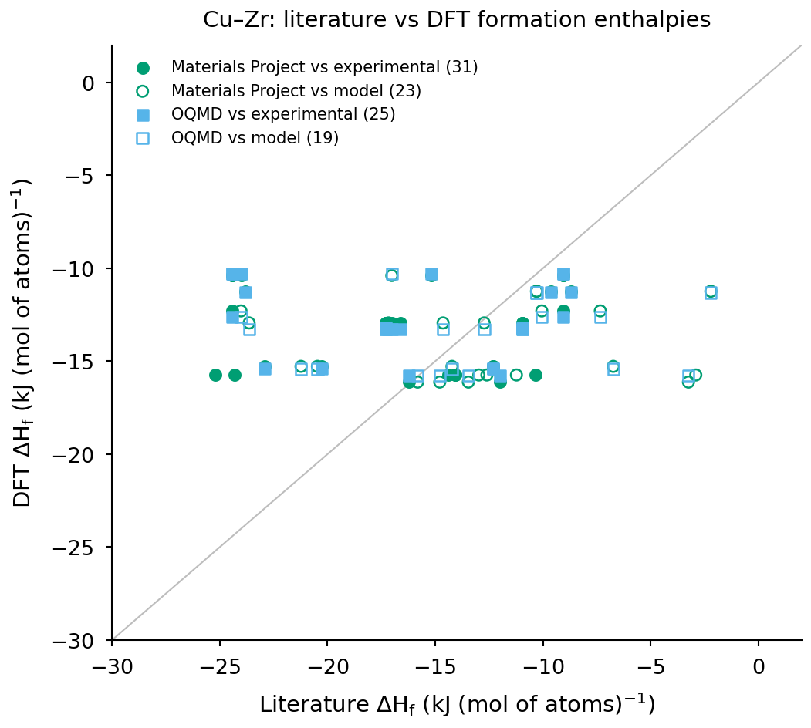

# Quickstart: one system from the ORCHID release to ESPEI

`quickstart.ipynb` (executed, outputs saved) shows the basic moves on Cu–Zr:

1. query a system from the Parquet release (`parquet/literature_values.parquet`);
2. filter values by `accepted`, `evidence_class` and `reader_agreement`;
3. plot experimental against DFT formation enthalpies (`parquet/dft_parity.parquet`, Materials Project and OQMD);
4. export the ESPEI datasets of one description (`espei/`, CuZr-94Zen-LB, experimental and invariant tables, no
   single-reader datasets) with an ESPEI input skeleton, and check them with ESPEI's `load_datasets`.



## Run

```sh
python -m venv .venv && . .venv/bin/activate      # CPython 3.12
pip install -r requirements.txt                  # exact versions; ESPEI 0.9.1 only for the optional check
sh run_quick.sh                                  # offline, on sample-release/ -> figures/cuzr_exp_vs_dft.{png,pdf}
jupyter lab quickstart.ipynb                     # or interactively (pip install jupyterlab)
```

Data: orchid-data commit **`c3d9781c26f72baaad64dd2b6aa6126ba487659e`** (release v2026.10, 2026-10-24). The
notebook resolves files through `../common/orchid_data.py`: `ORCHID_DATA` (a local checkout at that commit), else a
download from that commit on GitHub (cached in `~/.cache/orchid-examples`). `sample-release/` is the Cu–Zr slice of
the same commit in the release's layout (made by `scripts/make_sample_release.py`; the Parquet `quote` column is left
out, ESPEI files are unchanged), so the example runs offline; with the full release the figure is byte-identical
(checked). `scripts/build_notebook.py` writes the notebook; `scripts/run_notebook.py` executes it.

Values are Version 1, machine-extracted. Cite the ORCHID release and the original source of every value.
